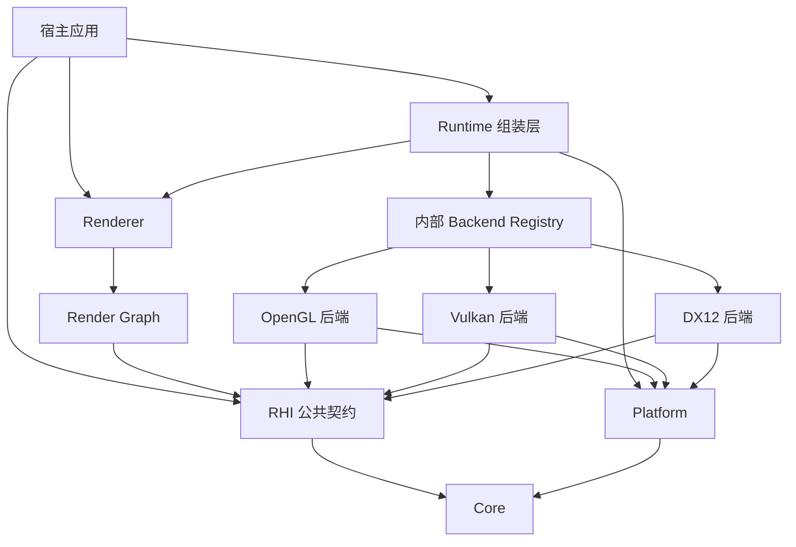

# VORYX C++ 框架设计

状态：0.1.0-draft.21。Core、缓冲 RHI、Null/Vulkan 缓冲与低层工厂已有实现，Win32、X11 与 Wayland 清屏和固定布局彩色与纹理三角形及显式资源绑定可用，设备级离屏绘制支持纹理、常量缓冲、索引和深度组合。Vulkan 设备命令支持离屏异步与窗口双帧提交，共享层管理命令完成与资源回收。Vulkan Presenter 提供显式限时关闭。完整 Runtime 和高层模块继续推进。文档索引见 [文档中心](README.md)，可用调用见 [缓冲 RHI](rhi-buffer-api.md)，完整目标见 [接口契约](api-reference.md)。

## 1. 范围与设计取舍

目标是让宿主应用通过一套 C++ API 使用渲染能力，首版同时面向 Windows 与 Linux。Vulkan/OpenGL 面向两平台，DX12 只纳入 Windows 支持。窗口系统、工具链与验收矩阵见 [跨平台设计](cross-platform.md)，不能将 Windows 运行成功视为 Linux 已支持。

采用 C++20 + CMake。先构建静态模块，后端可通过构建选项独立启用；初期不引入动态插件 ABI、全局服务定位器、通用事件总线或自动模块发现。

最终提供两层公共入口：高层 Renderer API 服务常规绘制，底层 RHI API 服务资源管理与自定义渲染。v0.1 先交付 Runtime + RHI，高层 Renderer / Render Graph 在后续版本定义，不能作为首版已有接口使用。C API 和其他语言绑定不属于第一阶段，避免同时维护两套尚未稳定的接口。

## 2. 依赖方向

箭头 A → B 表示 A 可以依赖 B。所有模块禁止反向包含和循环依赖。

Renderer 也可以直接使用 RHI 描述与接口；图中省略这条边以保持清晰。Render Graph 在基础 RHI 闭环之后实现，早期示例可直接使用 RHI。

| 模块 | 负责 | 不负责 |
| --- | --- | --- |
| Core | 错误类型、日志接口、基础标识与必要的内存工具 | 窗口、GPU 对象、材质、应用全局状态 |
| Platform | 原生窗口接入、Surface 所需的平台信息 | 渲染算法、GPU 资源分配、宿主主循环 |
| RHI | 设备能力、资源与命令接口、统一格式和同步契约 | 具体图形 API、相机、材质语义、后端发现 |
| Backend | 实现 RHI，转换资源、绑定、状态和同步操作 | 场景管理、材质系统、自动选择其他后端 |
| Render Graph | Pass 依赖、资源读写、屏障规划、瞬态资源生命周期 | 平台窗口、图形 API 句柄、材质业务 |
| Renderer | 视图、材质、网格绘制、阴影和后处理策略 | 直接调用 OpenGL/Vulkan/DX12 |
| Runtime | 选择后端、创建对象、组装依赖、安排销毁顺序 | 具体渲染算法与图形 API 调用 |
| Shader Tools | 离线编译、反射、绑定元数据、产物与缓存版本 | 运行时设备和窗口管理 |

Core 保持小而明确。只有被多个独立模块实际需要的基础能力才能下沉到 Core，不将各模块私有工具集中放入其中。

## 3. 目录和构建边界

完整目录树、文件命名、测试目录与 target 约定集中维护在 [目录规范](repository-layout.md)，不在多份文档复制目录树。公共头放 include/voryx/<module>/，私有头与实现放 src/<module>/，测试、样例、工具与生成产物分开。不要求立即创建空目录或空类。

每个实现模块对应一个 CMake target；RHI 公共契约单独作为接口 target，避免头文件依赖被误写为对实现库的依赖。各后端分别成为独立 target，SDK、链接库和私有 include 路径不传播给宿主。

公共头文件只包含公共依赖。后端头文件、SDK 头文件和内部注册接口不安装、不导出。静态 Vulkan SDK 包的链接依赖通过 find_dependency(Vulkan) 恢复，公共头仍不包含 Vulkan 类型。

当前共享缓冲状态机位于 src/rhi，对应 voryx_rhi（内部导出名 detail_rhi）。后端实现其私有存储/执行边界：Null 使用 CPU 字节，Vulkan 使用原生缓冲、屏障、队列和 fence。共享层不包含 SDK、不发现后端，也不依赖 Runtime 或具体后端。同步实现保留未来异步接口形状，但没有伪造 Pending 状态。CMake 中的 PUBLIC / PRIVATE 依赖与上述边界一致。

## 4. C++ 接口策略

### 4.1 真正的多态边界

RHI 使用少量运行时多态接口，初步包括 IDevice 和 ICommandList。后端实现这些接口，调用方只持有公共接口。接口具有虚析构，销毁路径不抛异常。

Buffer、Texture、Pipeline、BindingSet 等资源使用强类型句柄，不为每一种资源建立独立继承树。资源描述、格式、绑定布局采用普通值类型。

Renderer 与 Runtime 默认使用具体类；需要隐藏实现的公共类使用 PImpl。仅在存在替换需求时引入接口，避免给所有类机械增加 I 前缀和对应实现类。

初期 C++ API 只承诺在规定的工具链与构建配置下使用，不承诺跨编译器二进制兼容。接口冻结前不宣称稳定 ABI。

设备级 PipelineHandle 和 TextureHandle 由 RHI 统一校验并持有后端对象，录制命令保留资源引用。Vulkan 原生管线独立于窗口和几何，Presenter 也复用该实现。当前设备管线与离屏绘制的能力范围见接口指南。 [管线 API](rhi-pipeline-api.md) · [设备绘制](rhi-draw-api.md)

设备绑定集合持有布局、Buffer 字节范围、采样纹理与采样器。管线保留布局，命令保留集合及其录制引用。共享 RHI 校验状态与所有权，Vulkan 复用窗口路径的采样上传和描述符实现。 [设备绑定](rhi-binding-api.md)

Presenter 与设备命令共用同一 Vulkan Context。后端交换链拥有原生图像和视图，RHI 通过帧专用槽位借用图像，提交时检查帧令牌、颜色 Pass 和最终用途。 [窗口帧](window-frame-api.md)

### 4.2 创建与后端选择

Runtime 是组装模块。当前公开 CreateDevice(DeviceDesc) 提供 Null/Vulkan 无窗口设备，独立拥有 IDevice；未来窗口 Runtime::Create 再组装 Surface/Swapchain，不把窗口强加给无窗口调用者。

内部 Backend Registry 由组装层显式填充，收录本次构建实际启用的后端工厂。不使用静态对象构造时自动注册，避免初始化顺序和静态链接裁剪问题。

显式指定后端时，创建失败直接返回具体错误。Auto 在 Windows 按 Vulkan → DX12 → OpenGL、Linux 按 Vulkan → OpenGL 尝试并保留诊断；只有契约列出的环境/能力失败可以继续，参数或系统性错误直接终止。Null 必须显式选择。切换后端需要重建设备和资源，第一阶段不承诺热切换。

### 4.3 窗口与可嵌入性

已实现的 CreatePresenter 由 Runtime 选择后端。平台值描述和 RHI 呈现接口独立于图形 SDK。Vulkan 通用呈现实现持有设备、交换链与同步对象，Win32、Xlib 与 Wayland 各有私有 Surface 适配器。Wayland 的物理像素尺寸由宿主提供。此入口提供清屏和三角形阶段的窄接口，与无窗口缓冲设备独立。实际契约见 [Win32 清屏指南](win32-clear.md) 、[X11 清屏指南](xlib-clear.md) 和 [Wayland 清屏指南](wayland-clear.md)。

宿主拥有窗口和主循环。Platform 提供带平台标签的原生窗口描述，后端通过该边界创建 Surface；RHI 通用描述不包含 HWND、VkSurfaceKHR 等平台或图形 API 类型。

原生描述分别支持 Win32、Xlib、Wayland；连接、窗口及事件循环由宿主持有。后端通过私有 WSI 适配复用通用 GPU 实现，Core/RHI/Renderer 不包含系统头或散布平台宏。

窗口必须存活到对应 Surface 和 Swapchain 销毁之后。样例程序可以选择窗口库，但该依赖不进入引擎公共 API。第一阶段验证单窗口，接口不依赖全局唯一窗口。

当前纹理子集由 Presenter 管理单张采样图像。Vulkan 端封装上传、视图、采样器和描述符，复用已有的映射缓冲与三角形提交。公共 RHI 只描述像素、行距、UV 与 Shader。 [纹理接口](vulkan-texture.md)

启用深度绘制时，Vulkan 交换链按窗口像素尺寸拥有深度附件，帧缓冲在其之前销毁。单帧同步提交后才复用。切换绘制配置仍由 Presenter 管理，平台适配器不参与管线选择。 [深度接口](vulkan-depth.md)

索引绘制在同一 Presenter 下拥有顶点和索引缓冲。公共描述先完成范围验证，Vulkan 管线复用彩色布局。 [索引契约](vulkan-indexed.md)

Vulkan Presenter 的纹理、采样器、常量缓冲、布局和绑定使用强类型句柄。绑定集持有布局与资源，绘制持有绑定集。销毁验证依赖，图像和描述符寿命与平台适配分离。 [单槽绑定](vulkan-bindings.md) · [显式绑定](vulkan-binding-layout.md)

### 4.4 高层与低层互操作

Renderer 接收创建好的 RHI 设备，不自行隐藏创建第二个设备。常规用户通过 Renderer 提交绘制；高级用户通过显式的自定义 Pass 扩展点接入命令与资源读写声明。

同一帧中，不允许在 Renderer 管理之外任意修改其正在使用的资源状态。自定义 Pass 必须向 Render Graph 声明资源使用；独立 RHI 调用则由调用者承担完整同步责任。

## 5. RHI 语义

基础执行模型为：创建资源 → 录制命令 → 提交队列 → 获取完成标记 → 呈现 / 回收。

| 类别 | 设计约定 |
| --- | --- |
| 设备 | 每个设备独立管理资源和能力；不依赖全局当前设备 |
| 资源 | 使用带类型、代数与设备归属校验的句柄；拒绝跨设备混用 |
| 管线 | 用完整描述创建，显式表达 Shader、顶点布局、光栅与混合等状态 |
| 绑定 | BindingLayout 表达结构，BindingSet 表达具体资源；录制后使用期间不得随意覆盖 |
| 命令 | 明确初始、录制、可执行、执行中状态；执行中禁止重置和修改 |
| 同步 | 使用资源用途 / 访问描述与完成标记，后端映射为实际同步操作 |
| 队列 | 首期保证单图形队列；异步计算和独立传输队列作为可选能力 |
| 交换链 | 获取、渲染与呈现分别表达；过期、最小化与设备丢失有不同返回状态 |
| 能力 | 格式支持、对齐、数量限制和可选特性可查询；能力属于设备实例 |

共同基础能力保证三个后端可实现。Bindless、光追、Mesh Shader 等使用显式扩展能力，不通过静默模拟或随处判断后端类型实现。

RHI 公共契约不出现某个图形 API 专属枚举。确有原生互操作需求时，设计单独扩展入口并说明状态接管规则，不允许原生对象渗透到 Renderer。

OpenGL 后端采用 CPU 命令流并在上下文所属线程执行；管线和绑定由后端映射为 OpenGL 对象及状态。只缓存和修改引擎拥有的上下文状态，初期不支持与宿主任意交叉调用同一个上下文。

## 6. 所有权与销毁

| 对象 | 所有者 | 销毁要求 |
| --- | --- | --- |
| Runtime | 宿主 | 先停止提交，再依序释放其拥有的对象 |
| Device | Runtime 或低层宿主 | 所有使用者退出后销毁，负责最终排空或清理资源 |
| Renderer | 宿主或 Runtime | Device 必须比 Renderer 存活更久 |
| GPU 资源 | Device 内的资源表；调用方持有句柄 | 销毁后句柄立即失效，底层对象等待最后一次 GPU 使用完成 |
| CommandList | 创建方管理的命令池 / 所属线程 | 未完成提交不可重置；所引用资源必须保持有效 |
| Surface / Swapchain | Runtime 或显式创建方 | 在窗口销毁之前释放；重建前处理旧交换链的在途使用 |

RHI 共享层按提交顺序维护完成令牌和在途操作的强引用。Vulkan 后端持有 fence、命令池和临时 Pass，并提供查询、等待和回收。确认单图形队列的某批完成时，先回收原生命令，再释放该批及更早批次的资源引用。设备能力暴露在途批次数上限。Vulkan WSI 私有层持有两个窗口帧槽及各自的呈现信号量和 fence。RHI 校验活动帧与提交令牌，后端异步提交通过当前帧的原生存储绑定呈现信号量。交换链销毁前先释放仍借用其图像视图的命令，再确认在途呈现资源可回收。显式关闭共享同一个时间预算，依次排空设备命令及交换链的 fence，完成后释放 Vulkan 设备与表面。超时保留剩余工作以供重试。 [离屏异步提交规格](features/rhi-async-submit.md) · [窗口双帧规格](features/window-async-frames.md)

Destroy 必须检查资源是否仍被未提交的命令列表引用；第一版对此返回资源忙错误，要求先提交或重置相关命令。已提交的引用由完成标记保护。设备丢失进入专门清理路径，不能无限等待正常完成信号。

所有权以唯一所有者为主；观察关系使用引用或非拥有指针。只有确实存在共享生命周期时才采用 shared_ptr，禁止把所有 GPU 对象都交给共享引用计数管理。

上传接口必须区分“返回前复制输入数据”和“调用方持有到提交完成”两种契约；v0.1 使用复制并同步完成上传的接口，返回后输入可释放且资源可供后续提交使用。异步上传后续单独设计，不改变已有返回语义。异步加载产物通过显式队列移交，不隐式保留调用方临时地址。

## 7. 线程模型

首期使用宿主线程与单渲染线程；允许二者为同一线程。窗口事件归宿主处理，GPU 提交和呈现集中在渲染线程，OpenGL 上下文绑定在该线程。

- 一个 CommandList 同一时刻只有一个录制线程。
- 公共接口文档逐项标明线程要求，未声明可并发的接口默认要求外部同步。
- 首期资源创建和销毁也在渲染线程执行，后台线程只准备 CPU 数据。
- 后续并行录制使用每线程命令池和暂存内存，避免全局命令锁。
- 主线程向渲染线程移交自包含的帧数据；渲染线程不读取宿主正在修改的场景对象。
- 日志回调说明调用线程，不允许在回调中重入渲染接口。

## 8. Shader 与跨后端一致性

建议以受约束的 HLSL 子集作为主要源码，通过离线工具生成 DXIL、SPIR-V，以及供 OpenGL 使用的 GLSL。DXC 和 SPIRV-Cross 为候选工具，先用最小 Shader 集验证再固定版本。

公共 Shader 元数据统一表达绑定编号、资源类型和缓冲区布局。对 DXIL 与 SPIR-V 反射结果进行一致性检查，不能假设不同目标的布局天然一致。Renderer 只加载已验证产物，不依赖编译器 SDK。

统一定义矩阵存储与乘法约定、裁剪空间、深度范围、正面绕序和纹理原点；差异由 Shader 工具链及后端适配，不交给每个材质自行处理。

缓存键至少包含源码及依赖内容、宏、入口点、编译参数、目标后端、编译器版本和产物格式版本。驱动相关的 Pipeline 缓存独立于可移植 Shader 产物。

## 9. 错误与验证

公共操作通过统一 Result / Error 表达可恢复失败，包含错误类别与诊断文本。后端内部可保留原始错误码，但公共调用方无需包含 SDK 头文件。异常不作为常规公共错误通道。

验证模式检查句柄、设备归属、命令状态、绑定布局和资源用途；严重的契约违反在开发版本中尽早报错。区分配置错误、能力不支持、内存不足、交换链需重建与设备丢失。

Null 后端只验证 CPU 契约与命令流程，不能证明 GPU 绘制或同步正确。三个真实后端使用同一组图形样例，结合各自验证工具检查；图像对比采用允许数值差异的阈值，不要求不同 GPU 逐位相同。

## 10. 实施顺序与验收

1. 固定最小描述、句柄、错误、所有权与线程契约；两平台建立模块 target 和 CPU/Null 测试，验证生命周期。
2. 在两平台用 Vulkan 完成设备、交换链、上传、管线、三角形、纹理和深度绘制；分别覆盖 Win32、X11、Wayland 的缩放、最小化和资源回收。
3. Windows 接入 DX12，两平台接入 OpenGL，验证接口、状态与命令映射。
4. 完成最小 Renderer，再根据真实 Pass 引入 Render Graph；逐步增加材质、阴影和后处理。
5. 在三后端行为验证通过后评审公共 API，再考虑发布兼容策略、动态插件或语言绑定。

每个阶段必须能够独立构建和演示。第一阶段不实现完整场景系统、ECS、编辑器或资源数据库；引擎只接收必要渲染数据，避免与游戏业务绑定。

## 11. 变更检查规则

- Renderer 与 Render Graph 不得包含具体后端头文件或判断 BackendType。
- RHI 不得依赖 Runtime、Renderer 或具体后端。
- 后端之间不得互相引用；共用逻辑先确认语义真正一致后再提取。
- 后端注册和默认策略集中在 Runtime；库加载不产生设备、窗口或线程。
- 新接口必须说明所有权、线程要求、失败行为和 GPU 完成条件。
- 没有第二种实现或明确扩展需求时，不提前增加抽象层。

## 12. 设计参考

- [Microsoft：D3D12 命令队列与命令列表](https://learn.microsoft.com/en-us/windows/win32/direct3d12/command-queues-and-command-lists)
- [Khronos：Vulkan 同步指南](https://github.com/KhronosGroup/Vulkan-Guide/blob/main/chapters/synchronization.adoc)
- [Microsoft：DirectX Shader Compiler](https://github.com/microsoft/DirectXShaderCompiler)
- [Khronos：SPIRV-Cross](https://github.com/KhronosGroup/SPIRV-Cross)
