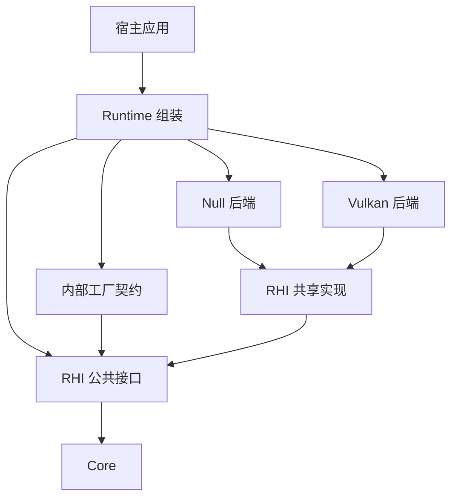

# 模块与工程目标说明

更新日期为 2026-11-26，依据当前源码和 CMake 目标整理。模块职责和依赖规则以架构文档为准，本页用于把职责对应到实际代码、构建目标和用户入口。当前交付状态集中见进度看板。 [架构](architecture.md) · [开发进度](project-status.md) · [目录规范](repository-layout.md)

## 核心模块

| 模块 | 主要职责 | 当前代码位置 | 构建与接入目标 |
| --- | --- | --- | --- |
| Core | 错误、结果和日志，明确诊断信息与回调的所有权 | `include/voryx/core/`、`src/core/` | `voryx_core`。对外为 `Voryx::core` |
| RHI 公共接口 | 设备、命令、缓冲、纹理附件、管线、Presenter 和资源绑定的公开类型与契约 | `include/voryx/rhi/` | `voryx_rhi_api` 为接口目标。对外为 `Voryx::rhi_api` |
| RHI 共享实现 | 缓冲与纹理状态、句柄归属和代数、命令引用、整批提交校验、完成查询与在途回收，以及管线、绘制和设备绑定校验 | `src/rhi/` | `voryx_rhi`。安装中的 `Voryx::detail_rhi` 用于内部链接 |
| 平台接入 | 用公共原生描述表达宿主窗口，具体系统调用由后端私有 WSI 完成 | `include/voryx/platform/native_window.hpp`、`src/backends/vulkan/wsi/` | 当前随公共头和 Vulkan 目标交付 |
| Runtime 组装 | 根据描述创建设备或 Presenter，连接已编译后端，分配设备身份并报告创建错误 | `include/voryx/runtime/`、`src/runtime/` | `voryx_runtime`。对外为 `Voryx::runtime` |
| 后端创建契约 | 给 Runtime 与后端提供内部工厂声明 | `src/backends/common/` | `voryx_backend_contract` 为内部接口目标 |
| Null 后端 | CPU 缓冲存储与复制、不可变管线描述存储，为共享契约提供执行环境 | `src/backends/null/` | `voryx_backend_null` |
| Vulkan 后端 | 真实设备、资源、同步、管线、离屏绘制与窗口呈现，将公共描述映射到 Vulkan | `src/backends/vulkan/` | `voryx_backend_vulkan` |

应用通常链接 `Voryx::runtime`，由导出依赖携带所需静态库。仅使用错误和日志时可链接 `Voryx::core`。`Voryx::detail_*` 由安装包用于解析内部链接依赖。 [SDK 接入](sdk-integration.md)

## 当前实现的依赖方向

下图中箭头表示左侧模块依赖右侧模块，后端节点按构建开关启用。

后端通过私有存储与执行边界接入共享校验，RHI 共享层使用接口调用后端对象。平台系统头与 Vulkan SDK 留在私有实现中。完整目标架构含后续 Renderer 和 Render Graph。 [完整依赖约束](architecture.md)

共享 RHI 的 `src/rhi/frame_device.cpp` 管理帧借用句柄、提交匹配、帧消费校验与交换链退役前的命令回收。Vulkan Presenter 管理两个呈现帧槽与限时关闭。RHI 控制关闭期间可使用的设备操作。

共享 RHI 的 `src/rhi/submission_state.cpp` 维护提交完成序号与在途引用。Vulkan 原生 fence、命令池与 Pass 由 `src/backends/vulkan/vulkan_buffers.cpp` 持有。 [窗口帧](window-frame-api.md) · [离屏异步提交](rhi-async-submit.md)

## Vulkan 私有实现分工

| 文件或目录 | 职责 |
| --- | --- |
| `src/backends/vulkan/vulkan_context.*` | 实例、设备、队列、能力与验证信息 |
| `src/backends/vulkan/vulkan_mapped_buffer.*` | 原生缓冲分配、映射、主机读写与可见性处理 |
| `src/backends/vulkan/vulkan_buffers.cpp` | 设备缓冲、管线、纹理与绑定创建，执行共享层验证后的缓冲、离屏和窗口绘制命令 |
| `src/backends/vulkan/vulkan_device_texture.*` | 设备颜色和深度图像、离屏帧缓冲、Pass 与图像屏障 |
| `src/backends/vulkan/vulkan_graphics_pipeline.*` | 独立 RenderPass、PipelineLayout 和 GraphicsPipeline 的创建与回收 |
| `src/backends/vulkan/vulkan_presenter.*` | 交换链、帧获取、取消、呈现、尺寸变化与设备借用 |
| `src/backends/vulkan/vulkan_triangle.*` | 已交付绘制入口的几何上传和命令记录，复用独立管线 |
| `src/backends/vulkan/vulkan_presenter_resources.*` | Presenter 所属资源的句柄、归属、引用和显式销毁 |
| `src/backends/vulkan/vulkan_sampled_texture.*` | 采样图像创建、像素上传与视图 |
| `src/backends/vulkan/vulkan_texture_binding.*` | 采样器与固定单槽组合纹理绑定 |
| `src/backends/vulkan/vulkan_binding_set.*` | 共享的显式槽位布局与原生描述符更新，支持 Presenter 常量缓冲和设备缓冲范围 |
| `src/backends/vulkan/vulkan_depth_target.*` | 深度格式选择和附件分配 |
| `src/backends/vulkan/wsi/` | Win32、Xlib 和 Wayland 的私有 Surface 适配 |

共享管线与具体几何分别拥有寿命。设备管线句柄和 Presenter 资源分别归属各自创建者，当前可用接口与组合限制见相应指南。 [管线接口](rhi-pipeline-api.md) · [Presenter 绑定](vulkan-binding-layout.md)

## 样例、测试与质量目标

| 目标 | 用途 | 常见使用方式 |
| --- | --- | --- |
| `voryx_core_diagnostics` | 错误、结果和日志的命令行示例 | 构建后直接运行 |
| `voryx_null_buffers` | 公开缓冲接口的上传、复制和读回示例 | 默认 Null，启用 Vulkan 后可传 `--vulkan --validation` |
| `voryx_win32_clear` | Windows 宿主窗口与 Vulkan 绘制示例 | 在 Visual Studio 设为启动项目 |
| `voryx_xlib_clear` | Linux X11 宿主窗口示例 | 在对应构建配置下运行 |
| `voryx_wayland_clear` | Linux 原生 Wayland 宿主窗口示例 | 在对应构建配置下运行 |
| `voryx_environment_tests` | C++20、线程同步与中文路径验证 | 由 CTest 调度 |
| `voryx_core_tests` | Core 单元测试 | 由 CTest 调度 |
| `voryx_rhi_contract_tests` | Null 后端的资源、命令、管线、设备 Pass 与工厂契约 | 由 CTest 调度 |
| `voryx_vulkan_contract_tests` | 实际 Vulkan 设备上的共享资源、命令、管线与设备绘制契约，含公开命令的像素读回 | 启用 GPU 测试后由 CTest 调度 |
| `voryx_vulkan_triangle_tests` | 离屏读回，验证颜色、纹理、深度、索引、绑定与独立管线 | 启用 GPU 与对应窗口配置后由 CTest 调度 |
| `voryx_core_headers_check`、`voryx_rhi_headers_check` | 各公共头独立包含与编译检查 | 在构建阶段完成 |
| `voryx_format_check` | 按根 `.clang-format` 检查排版 | 构建该目标或运行质量测试 |
| `voryx_braces_check` | 使用 clang-tidy 检查完整花括号 | 构建该目标或运行质量测试 |
| `voryx_quality` | 汇总格式与完整括号检查 | 统一质量入口 |

三个窗口样例支持 `--triangle`、`--texture`、`--depth`、`--indexed`、`--binding` 和 `--resources`。`--verify` 执行自动窗口验收。软件 Vulkan 设备需显式允许，参数与平台前置条件见各窗口指南。 [Win32](win32-clear.md) · [X11](xlib-clear.md) · [Wayland](wayland-clear.md)

`integration.installed_sdk` 是 CTest 测试名，负责安装、迁移前缀及独立消费。它构建的 `sdk_consumer` 和 `pipeline_consumer` 位于测试生成的独立用户工程中。对应源码位于 `tests/integration/sdk_consumer/`。 [安装消费流程](sdk-integration.md)

Visual Studio 的 `ALL_BUILD`、`ZERO_CHECK`、`INSTALL` 和 `RUN_TESTS` 由 CMake 生成，分别服务构建汇总、配置检查、安装和测试调度。`gtest`、`gtest_main` 为 GoogleTest 依赖库。日常运行窗口画面时选择窗口样例目标。

## 工具与资产

| 位置 | 内容 |
| --- | --- |
| `tools/environment/` | 构建预设入口、Windows 开发环境初始化和环境辅助工具 |
| `tools/quality/` | 格式、括号和检查链路自检工具 |
| `tools/shader_compiler/` | 当前 GLSL 样例的离线编译与 SPIR-V 夹具生成脚本 |
| `assets/shaders/` | 共用 Shader 源码与生成夹具 |
| `tests/` | 环境、单元、契约、集成及 GPU 验证，测试辅助代码集中在 `tests/support/` |
| `docs/` | 规格、架构、接口、接入、验证和开发记录 |
| `build/<preset>/` | 各配置的构建产物、依赖解压、临时工程和测试报告 |

## 后续模块

| 模块或能力 | 当前状态 | 后续条件 |
| --- | --- | --- |
| OpenGL 后端 | 待实现 | 接入公共 RHI，并分别验证 Windows、X11 和原生 Wayland |
| DX12 后端 | 待实现 | 接入公共 RHI，完成 Windows 验收 |
| 通用窗口 Runtime | 已有同步 Presenter 帧路径 | 实现异步多帧、在途资源回收和显式关闭契约 |
| 高层 Renderer | 规格阶段 | 基础 RHI 与多后端行为达到架构要求 |
| Render Graph | 后续设计 | 出现至少两类真实资源依赖的 Pass 后，再确定结构 |
| 通用 Shader 工具链 | 部分基础工具已交付 | 补充跨后端产物、反射、元数据与兼容校验 |

后续模块的功能范围与进入条件由功能规格维护。 [功能边界](requirements.md) · [后续顺序](project-status.md)
